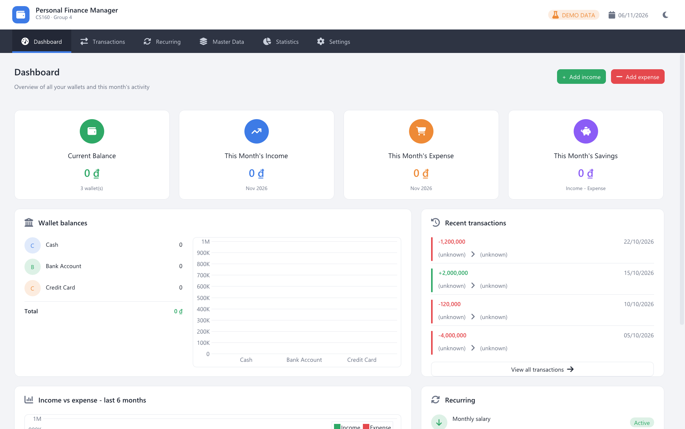
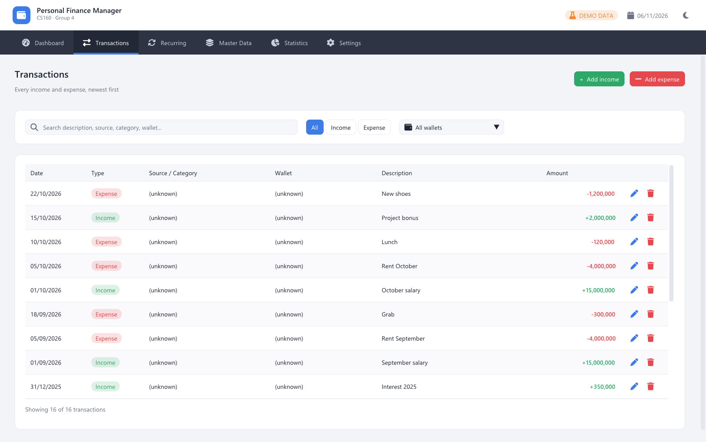
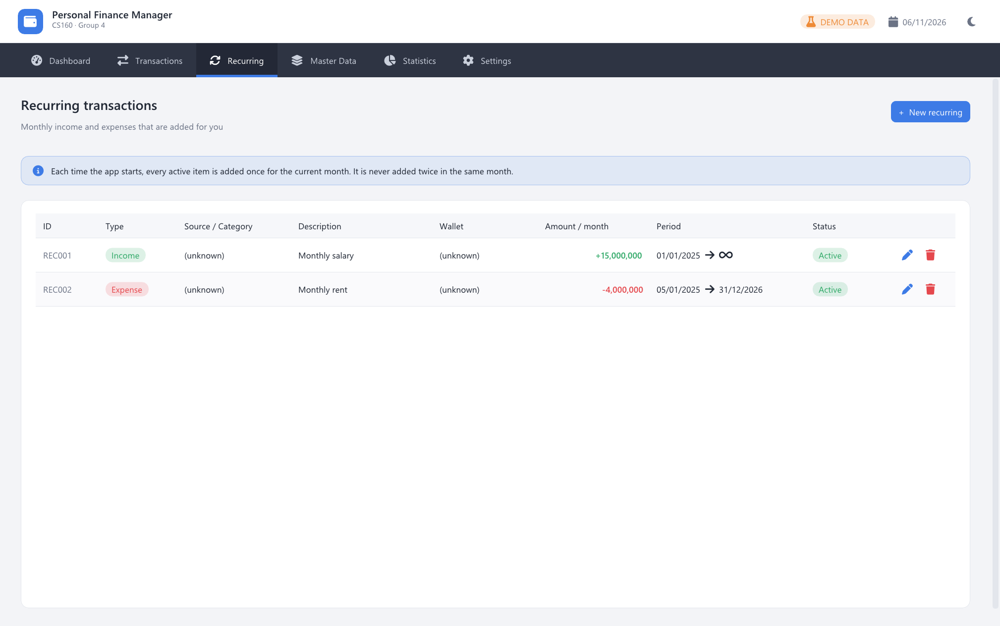

# Weekly Report – Group04 – Week 01

**Project:** Personal Finance Manager (CS160, FIT – VNU-HCMUS)
**Practice week:** 01 (02/11/2026 – 06/11/2026)

| Student ID | Name | Module |
|---|---|---|
| 23125084 | Nguyễn Đăng Khoa | GUI, Recurring, AnnualStatistics |
| 24125028 | Trương Thị Mỹ Duyên | MasterData, Balance |
| 26125042 | Huỳnh Phước Trung Kiên | Transactions |
| 26125060 | Dương Minh Quân | Storage, Statistics |

## 1. Work done this week

| Member | Work | Commits | Status |
|---|---|---|---|
| Nguyễn Đăng Khoa | Full GUI (Dashboard, Transactions, Recurring, Master Data, Statistics, Settings; light/dark theme, dialogs, date picker). Recurring CRUD (add / update / delete) and `containsYear`, with unit tests. | `9c8253b`, `4975c8f` | Done |
| Huỳnh Phước Trung Kiên | `addIncomeRecord`, `addExpenseRecord`, `getSortedTransactions` (newest first), `updateIncome`, `updateExpense`. | `fa3f8a5`, `ea5b508`, `464b868`, `abb1a25` | Done (delete still to do) |
| Dương Minh Quân | `Storage::save` and `Storage::load` (binary file with `<fstream>`): data is kept after closing the app. | `a1cf31a` | Done |
| Trương Thị Mỹ Duyên | MasterData and Balance. | – | Not committed yet |

## 2. Results

All three week-1 branches (`Khoa_Tuan1`, `Kien-transactions`, `quan-storage-tuan1`) merge into `main` without conflicts, the app builds, and `build.bat test` prints **All tests passed.**

The screenshots below were taken from this merged build in demo mode (`run_demo.bat`).
Names show `(unknown)` and wallet balances show `0` because `MasterData` and `Balance` are not implemented yet.

### Dashboard
Recent transactions and the recurring list now show real data.

### Transactions
All 16 demo transactions are listed newest first (`getSortedTransactions`), with edit / delete buttons.

### Recurring
Recurring items with their period (start date → end date or ∞) and status.

## 3. Plan for next week

- Merge the week-1 branches into `main` through Pull Requests.
- Duyên: `MasterData` (categories, sources, wallets) and `Balance` so names and balances show up.
- Kiên: delete income / expense.
- Quân: `Statistics::summarize` (this month cards, 6-month chart, Date range / By wallet).
- Khoa: apply recurring items each month and `AnnualStatistics`.

## 4. Issues

- Duyên has no commit in the repo yet.
- The week-1 work is still on separate branches and not merged into `main`.

## 5. Demo video

_(link)_
