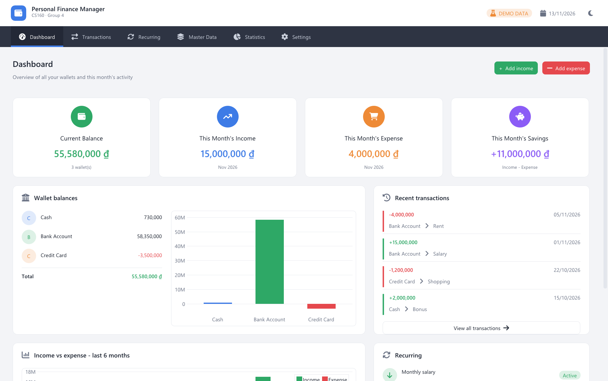
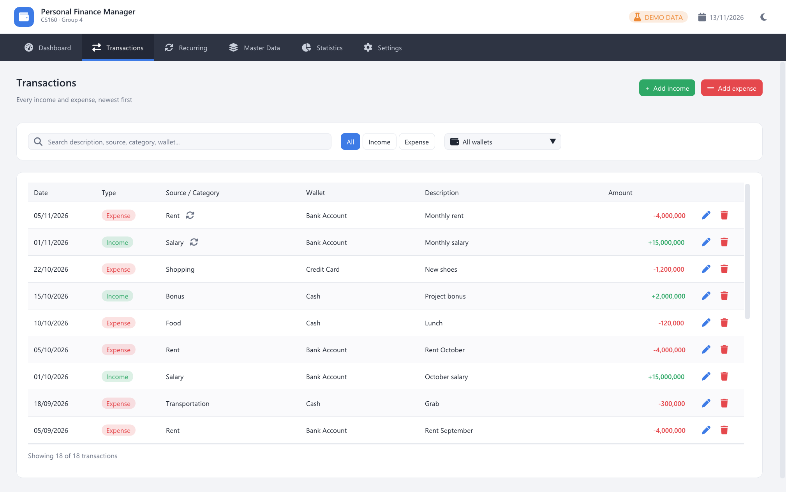
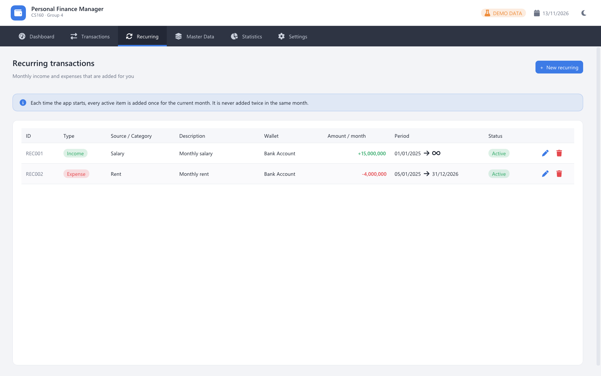
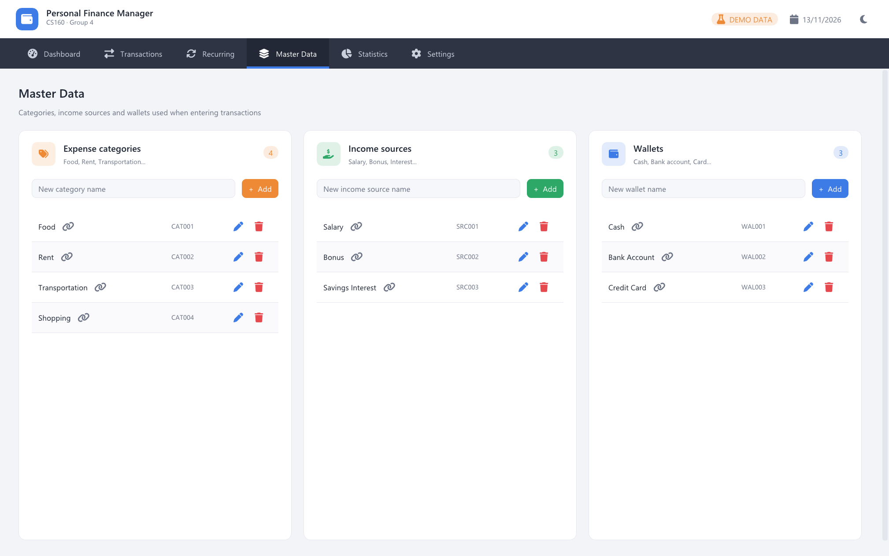
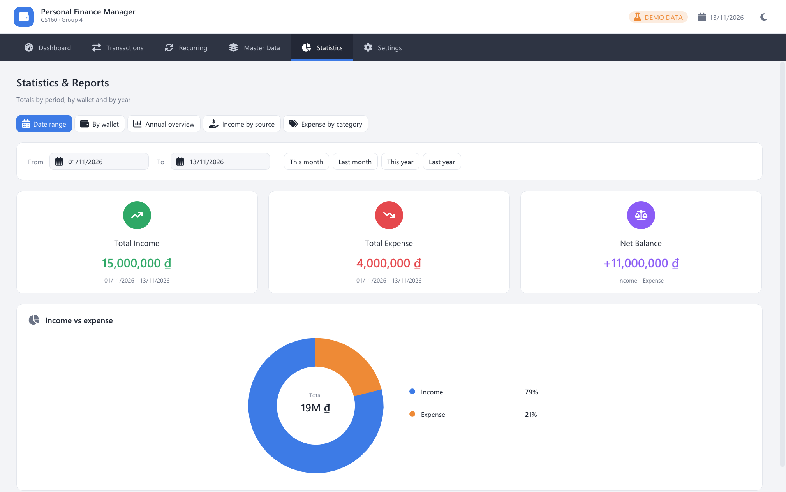
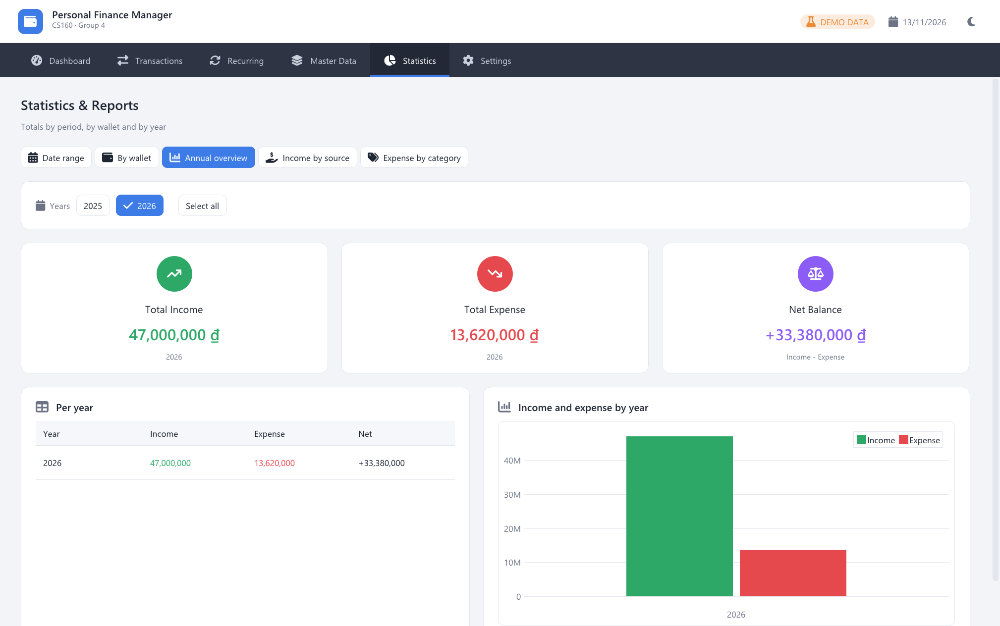

# Weekly Report – Group04 – Week 02

**Project:** Personal Finance Manager (CS160, FIT – VNU-HCMUS)
**Practice week:** 02 (09/11/2026 – 13/11/2026)

| Student ID | Name | Module |
|---|---|---|
| 23125084 | Nguyễn Đăng Khoa | GUI, Recurring, AnnualStatistics |
| 24125028 | Trương Thị Mỹ Duyên | MasterData, Balance |
| 26125042 | Huỳnh Phước Trung Kiên | Transactions |
| 26125060 | Dương Minh Quân | Storage, Statistics |

## 1. Work done this week

| Member | Work | Commits | Status |
|---|---|---|---|
| Nguyễn Đăng Khoa | Merged the week-1 branches (`quan-storage-tuan1`, `feature/wallet-balance`, `Kien-transactions`, `Khoa_Tuan1`) into `main`. `Recurring::generateDueTransactions`: creates the income / expense of each recurring item once per month, only between the start and end month, on the same day as the start date (31 becomes the last day of a shorter month), and skips items whose source, category or wallet no longer exists. `AnnualStatistics`: `summarizeYears`, `incomeBySource`, `expenseByCategory` for the selected years. Real error messages on the Recurring page. Unit tests and edge-case tests. | `280e9c9`, `11233ef`, `4207a4b`, `dbfd983`, `d4039f1`, `3a97086`, `2a3cae5` | Done |
| Huỳnh Phước Trung Kiên | `deleteTransaction` (delete income / expense). Unit tests for `getSortedTransactions`, `deleteTransaction`, `updateIncome` / `updateExpense`. | `e2fa16c`, `93cab9c`, `cb61e6b`, `d1d696a` | Done |
| Trương Thị Mỹ Duyên | `isCategoryInUse`, `isSourceInUse`, `isWalletInUse` (PR #2). `renameItem` (rejects empty and duplicate names, case ignored) and `removeItem` (refuses an item that is in use; the deleted ID is not reused) (PR #3). Tests for duplicate names, removing items in use, balance after update / delete, negative wallet balance (PR #4). | `43385d1`, `fb7c9b6`, `05a3f09`, `f767889`, `8450437`, `c31102e`, `3d173c4`, `faae24f`, `393005e`, `f5f2178` | Done (PRs #2, #3, #4 open, not merged yet) |
| Dương Minh Quân | `Statistics::summarize`: total income / expense between two dates (both included), for all wallets or for one wallet. This fills the "this month" cards and 6-month chart on the Dashboard and the Date range / By wallet reports on the Statistics page (PR #5). | `286fae7` | Done (PR #5 open, not merged yet; no unit tests yet) |

## 2. Results

All week-1 branches are now merged into `main` (merge commits `280e9c9`, `11233ef`, `4207a4b`, `dbfd983`). Kiên's week-2 commits were already in `Kien-transactions` when it was merged, so `deleteTransaction` and its tests are in `main` too.

Khoa's week-2 work is on branch `Khoa` (based on the new `main`).

Trial merge of `main` + `Khoa` + `quan-statistics-tuan2` + `feature/balance-master-data-tests` (which already contains PRs #2 and #3) has two conflicts:

- `src/Statistics.cpp`: Quân's branch starts from the old console skeleton (`f30a059`), so it also adds a console `showMenu` that `main` no longer has. Keeping only his `summarize` fixes it.
- `tests/test_core.cpp`: both sides add test functions at the end of the file. Keeping both sides fixes it.

After that, `build.bat test` builds the app and prints **All tests passed.**

The screenshots below were taken from this trial merge in demo mode (`run_demo.bat`) on 13/11/2026.

### Dashboard
Wallet balances and this month's income / expense (`Statistics::summarize`) now show real data.

### Transactions
18 transactions: the 16 demo ones plus the November salary (01/11) and rent (05/11) added by `generateDueTransactions` when the app started (recurring icon next to the name).

### Recurring
The two recurring items that the November transactions above come from.

### Master Data
Categories, income sources and wallets, with rename and delete buttons (`renameItem`, `removeItem`).

### Statistics – Date range
Totals from 01/11/2026 to 13/11/2026 (`Statistics::summarize`).

### Statistics – Annual overview
Totals for the selected years (`AnnualStatistics::summarizeYears`).

## 3. Plan for next week

- Merge branch `Khoa` and PRs #2, #3, #4, #5 into `main` (keep both sides in `tests/test_core.cpp`).
- Quân: rebase `quan-statistics-tuan2` on the new `main` (keep only `summarize` in `src/Statistics.cpp`), add unit tests for `summarize`.
- Duyên: test rename / remove on the Master Data page after the merge.
- Kiên: test the Transactions page end to end (add / edit / delete) after the merge.
- Khoa: test the whole app on the merged `main` (recurring items generated at startup, Annual statistics), fix bugs.

## 4. Issues

- Quân's PR #5 is based on the old skeleton, not on the current `main`, so it conflicts in `src/Statistics.cpp` (old console menu code). It was pushed late on 13/11 and has no unit tests yet.
- Duyên's PRs #2, #3, #4 are stacked (each one is built on the previous one) and must be merged in order.
- The week-1 branches were merged into `main` directly, not through Pull Requests.

