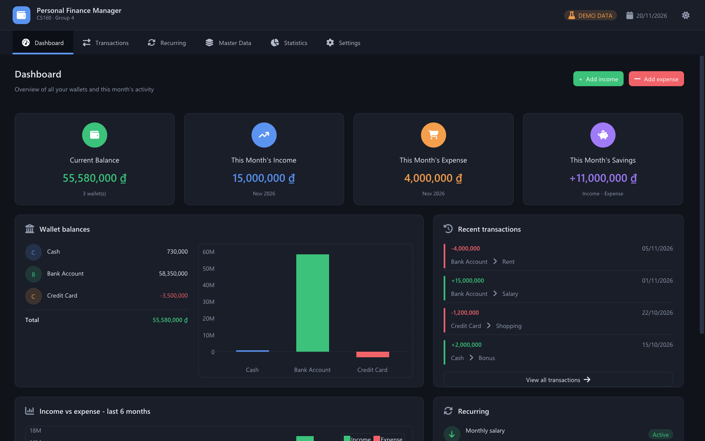
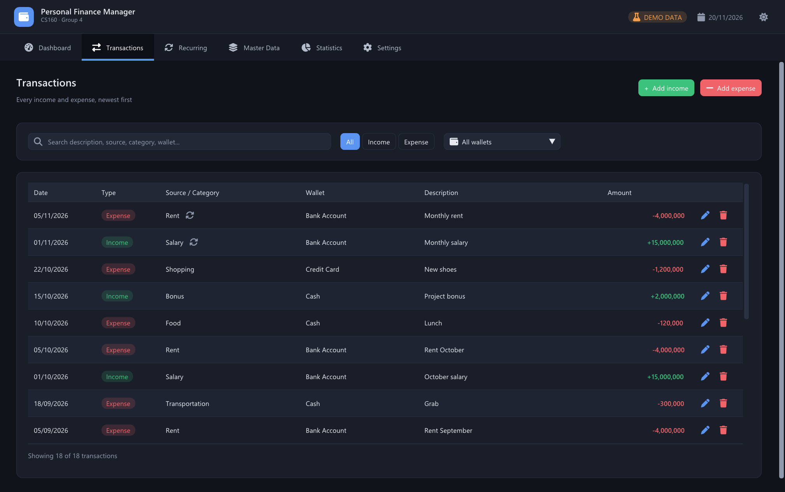
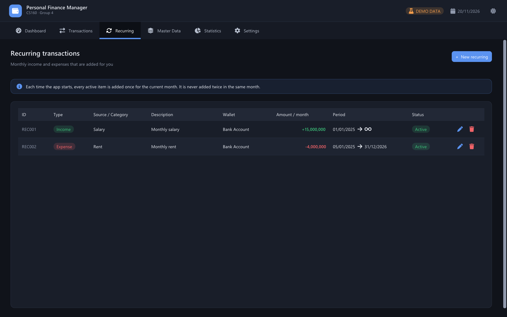
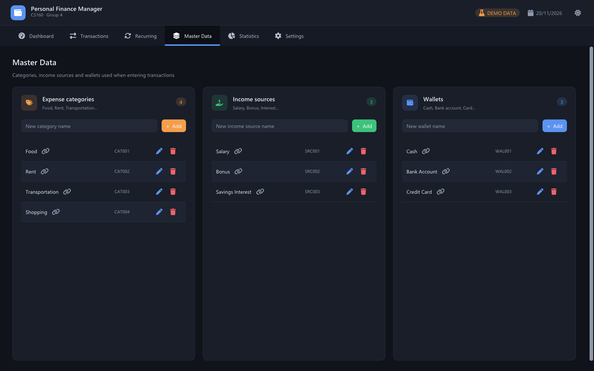
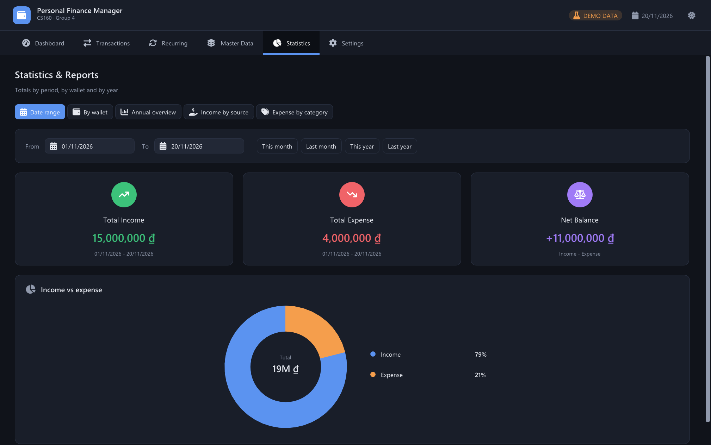
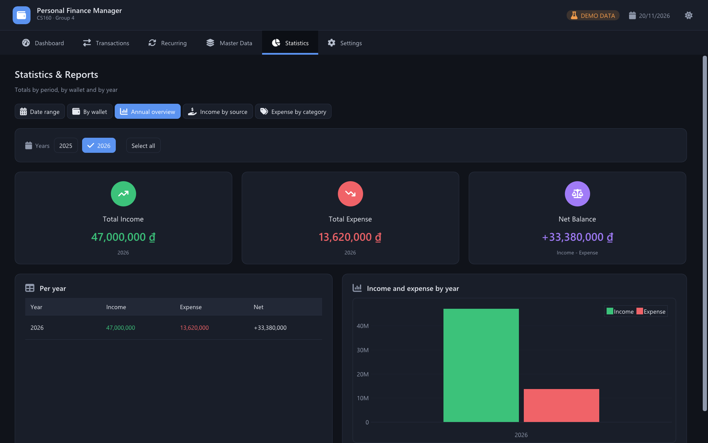

# Weekly Report – Group04 – Week 03

**Project:** Personal Finance Manager (CS160, FIT – VNU-HCMUS)
**Practice week:** 03 (16/11/2026 – 20/11/2026)

| Student ID | Name | Module |
|---|---|---|
| 23125084 | Nguyễn Đăng Khoa | GUI, Recurring, AnnualStatistics |
| 24125028 | Trương Thị Mỹ Duyên | MasterData, Balance |
| 26125042 | Huỳnh Phước Trung Kiên | Transactions |
| 26125060 | Dương Minh Quân | Storage, Statistics |

## 1. Work done this week

| Member | Work | Commits | Status |
|---|---|---|---|
| Nguyễn Đăng Khoa | Merged branch `Khoa` and PRs #2, #3, #4, #5, #6 into `main`. Fixed the merge conflicts: `tests/test_core.cpp` (PRs #4 and #6: kept the tests of both sides), `src/Statistics.cpp` (PR #5: kept only `summarize`, removed the old console menu that `main` no longer has). Checked that every line added on each branch is in `main` and ran `build.bat test` before pushing. The week-3 tests for Recurring and AnnualStatistics (same month twice, after End Date, before Start Date, several years) were written last week (`d4039f1`, `2a3cae5`) and are now in `main`. | `3eb473a`, `d74037b`, `987413d`, `2a52106`, `a5acac6`, `1ed6693` | Done |
| Dương Minh Quân | `testStorageEdgeCases`: empty data is saved and loaded; full round trip (all lists and the 6 `nextXxxNo` counters come back the same); missing, empty (0 bytes) and corrupted files (garbage, huge string length, negative count); files cut after a few bytes, in the middle and just before the end. In every bad case `Storage::load` returns false and does not crash (PR #6). | `7bee238`, `542f048`, `e4628fd`, `aa5092e` | Done (PR #6 merged) |
| Trương Thị Mỹ Duyên | Week-3 tests (PR #4, written 13/11) merged this week. Started the week-4 cross test of Kiên's Transactions module (PR #7): `testCrossAddTransactions` (IDs, no gap after bad input, amounts above `int`), `testCrossSortedOrder` (same date, month and year borders), `testCrossUpdateTransactions`, `testCrossDeleteTransactions`, `testCrossTransactionsWithOtherModules` (balance, names, wallet in use). | `44d3167`, `a35c0ed`, `3ca6233`, `c585cb6`, `9d4e4f4` | Done (PR #7 open) |
| Huỳnh Phước Trung Kiên | Week-3 tests (sort order with the same date, delete first / middle / last, update to another wallet) are already in `main` since week 2. Started the week-4 cross test of Duyên's MasterData module: lookup of the first / middle / last item, rename a category, remove the middle item, deleted source ID is not reused, `isXxxInUse` after deleting or updating an income / expense, names with tabs are trimmed. | `3618663`, `e67cf84`, `86efcbc`, `0171219`, `ed29009`, `68691aa`, `6a690c7`, `ebece15` | Done (branch `Kien-week4-report`, no PR yet) |

## 2. Results

Week-3 milestone (`build.bat test` passes) is reached. All work of weeks 1–3 is now in `main` and PRs #2 to #6 are merged.

`build.bat test` on `main` (`1ed6693`, 20/11/2026):

> Built bin\PersonalFinanceManager.exe
> All tests passed.

| | `main` at the start of the week (`dbfd983`) | `main` now (`1ed6693`) | `main` + PR #7 + `Kien-week4-report` (trial merge) |
|---|---|---|---|
| Test functions | 11 | 20 | 31 |
| `CHECK`s | 157 | 428 | 715 |
| Result | All tests passed | All tests passed | All tests passed |

The trial merge of PR #7 and `Kien-week4-report` into `main` has no conflicts.

Week-3 test plan vs. tests in the code:

| Member | Week-3 plan | Test functions |
|---|---|---|
| Khoa | Open the app twice in the same month (no duplicates), month after End Date, month before Start Date, several years | `testGenerateDueTransactions`, `testRecurringEdgeCases`, `testAnnualStatisticsEdgeCases` |
| Kiên | Sort order (also the same date), delete first / middle / last, move a transaction to another wallet | `testSortedTransactions`, `testDeleteTransaction`, `testUpdateTransactions` |
| Duyên | Duplicate names, remove an item in use, balance after update / delete, negative wallet | `testMasterDataDuplicateNames`, `testMasterDataRemoveInUse`, `testBalanceAfterTransactionChanges`, `testBalanceNegativeWallet` |
| Quân | Save then load gives the same data, broken or cut files do not crash, empty lists can be saved | `testStorageEdgeCases` |

The screenshots below were taken from the merged `main` (`1ed6693`) in demo mode (`run_demo.bat`) on 20/11/2026.

### Dashboard
Wallet balances (`Balance`) and this month's income / expense (`Statistics::summarize`).

### Transactions
18 transactions: the 16 demo ones plus the November salary (01/11) and rent (05/11) added by `generateDueTransactions` when the app started (recurring icon next to the name).

### Recurring
The two recurring items that the November transactions above come from.

### Master Data
Categories, income sources and wallets, with rename and delete buttons (`renameItem`, `removeItem`, merged this week with PRs #2 and #3).

### Statistics – Date range
Totals from 01/11/2026 to 20/11/2026 (`Statistics::summarize`, merged this week with PR #5).

### Statistics – Annual overview
Totals for 2026 (`AnnualStatistics::summarizeYears`).

## 3. Plan for next week

- Week 4: cross test, fix bugs, code freeze at the end of the week.
- Duyên and Kiên: review each other's cross tests and merge PR #7. Kiên opens a PR for `Kien-week4-report`.
- Quân: cross test Khoa's module (Recurring, AnnualStatistics).
- Khoa: cross test Quân's module (Storage, Statistics) and add unit tests for `Statistics::summarize`.
- Everyone: write the bugs found in GitHub Issues, then fix them. Check again that no STL container is used.

## 4. Issues

- PRs #2 to #6 were merged without a review. The review pairs (Duyên ↔ Kiên, Quân ↔ Khoa) have to be used for the week-4 PRs.
- `Statistics::summarize` still has no unit tests.
- `testRecurringEdgeCases` writes to `bin/test_recurring.dat`. The tests pass with `build.bat test`, but they crash (`DynamicArray: index out of range`) when `run_tests.exe` is started from a folder without `bin/`. To fix in week 4.
- `Kien-week4-report` was started from the old branch `feature/balance-master-data-tests`, not from the new `main`. It still merges without conflicts.
